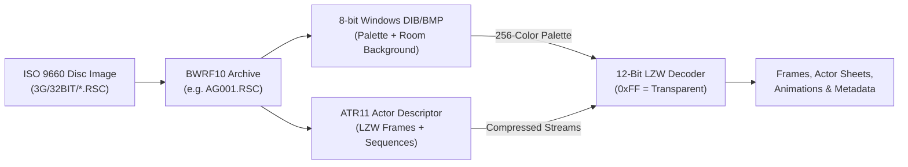

# ATR (`ATR11`) & RSC (`BWRF10`) Technical Specification

This document synthesizes the complete binary specifications for Knowledge Adventure's **`.ATR` (`ATR11`)** sprite and trajectory descriptor format, the **`.RSC` (`BWRF10`)** resource bundle format, and the **12-bit MSB-first transparency-segregated LZW** pixel compression scheme used in **JumpStart Adventures 3rd Grade: Mystery Mountain (1996)**.

All findings were reverse-engineered directly from the original 32-bit Windows PE executable (`3G.EXE`) and verified with zero decode errors across all 39 resource bundles on the retail CD-ROM.

---

## 1. End-to-End Asset Pipeline (ISO $\rightarrow$ RSC $\rightarrow$ ATR + BMP)



1. **ISO 9660 Disc Layout**: On the JumpStart 3rd Grade CD-ROM, the 32-bit module archives reside under `3G/32BIT/*.RSC` (39 module bundles such as `AG001.RSC`, `CR001.RSC`, `TA001.RSC`).
2. **`BWRF10` Resource Bundles (`.RSC`)**: Each `.RSC` archive is a flat, uncompressed container holding:
   - One or more **8-bit indexed `.BMP`** files (e.g., `AG001.BMP`), which provide both the 640×480 room background image and the **256-color RGB palette** for all sprites in that scene.
   - Dozens of **`.ATR` (`ATR11`)** actor files describing sprites, hitboxes, UI buttons, and character animations.
3. **Palette Coupling**: `.ATR` files do **not** store an embedded RGB color table. Instead, the header's `bitmap` field (`offset 0x15`) names the `.BMP` resource whose 256-color palette must be applied to the decoded 8-bit pixel indices. Index `0xFF` (`255`) is strictly reserved as the transparent color key.

---

## 2. `BWRF10` Resource Container Format (`.RSC`)

Reverse-engineered from `CResourceManager::LoadArchiveTable` (`0x00486360`) and `CResourceManager::OpenFile` (`0x00486890`). All integers are little-endian.

### 2.1 File Header (`10 bytes`)

| Offset | Size | Type      | Field     | Description                                   |
| ------ | ---- | --------- | --------- | --------------------------------------------- |
| `0x00` | `4`  | `char[4]` | `magic`   | ASCII `"BWRF"`                                |
| `0x04` | `2`  | `char[2]` | `version` | ASCII `"10"` (`major = '1'`, `minor = '0'`)   |
| `0x06` | `4`  | `uint32`  | `count`   | Number of 20-byte directory entries following |

### 2.2 Directory Entry (`20 bytes` $\times$ `count`, starting at `0x0A`)

| Offset | Size | Type       | Field    | Description                                                      |
| ------ | ---- | ---------- | -------- | ---------------------------------------------------------------- |
| `0x00` | `12` | `char[12]` | `name`   | NUL-padded 8.3 ASCII filename (case-insensitive, e.g. `BOT.ATR`) |
| `0x0C` | `4`  | `uint32`   | `offset` | Absolute byte offset from start of `.RSC` file                   |
| `0x10` | `4`  | `uint32`   | `size`   | Uncompressed payload size in bytes                               |

---

## 3. `ATR11` Sprite & Trajectory Format (`.ATR`)

Reverse-engineered from:

- `CTrajectoryActor::LoadATR` (`0x00479EB0`)
- `CTrajectoryNode::ReadFrameBitmap` (`0x00479840`)
- `CTrajectoryPath::ReadPathData` (`0x00479A60`)
- `CTrajectoryActor::UpdatePositionClamped` (`0x0047BB10`)

All multi-byte integers are little-endian, and all fixed-length strings are NUL-padded `latin-1`. Every valid `.ATR` file ends at exact `EOF` with `0` trailing bytes.

### 3.1 File Header (`0x49` / `73 bytes`)

| Offset | Size | Type       | Field      | Engine Member | Description                                                                  |
| ------ | ---- | ---------- | ---------- | ------------- | ---------------------------------------------------------------------------- |
| `0x00` | `3`  | `char[3]`  | `magic`    | —             | ASCII `"ATR"`                                                                |
| `0x03` | `2`  | `char[2]`  | `version`  | —             | ASCII `"11"`                                                                 |
| `0x05` | `16` | `char[16]` | `name`     | `m_str1`      | Logical actor identifier (NUL-padded)                                        |
| `0x15` | `16` | `char[16]` | `bitmap`   | `m_str2`      | Palette/background `.BMP` name (`"dummy.bmp"` = invisible hitbox actor)      |
| `0x25` | `16` | `char[16]` | `parent`   | `m_str3`      | Parent `.ATR` name. Empty (`""`) if this file embeds its own `IMAGE` records |
| `0x35` | `4`  | `uint32`   | `asset_id` | `m_field_70`  | Exporter / authoring asset ID tag (e.g. `911`, `1900`; preserved on clone)   |
| `0x39` | `4`  | `uint32`   | `flags`    | `m_flags_7c`  | Bitmask controlling decompression, callbacks, and background buffers         |
| `0x3D` | `4`  | `uint32`   | `width`    | `dummy1`      | Max frame width across owned or referenced frames                            |
| `0x41` | `4`  | `uint32`   | `height`   | `dummy2`      | Max frame height across owned or referenced frames                           |
| `0x45` | `4`  | `uint32`   | `n_images` | `nodeCount`   | Number of frames owned (or inherited when `parent` is non-empty)             |

#### Header `flags` Bitmask (`offset 0x39` / `m_flags_7c`)

| Bit     | Mask   | Meaning in `3G.EXE`                                                                                                                                                                                                                                                                         |
| ------- | ------ | ------------------------------------------------------------------------------------------------------------------------------------------------------------------------------------------------------------------------------------------------------------------------------------------- |
| Bit `0` | `0x01` | **Movement Callback Trigger**: Invokes movement notification handler (`0x0047C260`) whenever the actor's position changes.                                                                                                                                                                  |
| Bit `2` | `0x04` | **Load-Time LZW Decompression**: If set, frames are LZW-decoded into an `width * height` RAM buffer during `ReadFrameBitmap` and blitted via `0x0047F030`. If clear, LZW streams remain compressed in memory and are decoded on-the-fly during scanline rendering (`0x0047F340`).           |
| Bit `4` | `0x10` | **Disable Background Scratch Buffer**: If clear (`0`), `LoadATR` allocates a `GlobalAlloc` buffer of `maxWidth * maxHeight` bytes used by `RestoreBackground` (`0x0047B400`) to save and restore dirty background pixels under the sprite. If set (`0x10`), no scratch buffer is allocated. |

> [!IMPORTANT]
> **Parent vs. Child ATRs (`offset 0x25`)**
>
> - If `parent[0] == '\0'`, `n_images` `IMAGE` records immediately follow offset `0x49`.
> - If `parent[0] != '\0'`, **zero** `IMAGE` records are stored in the file (`0x49` is immediately followed by `n_seq`). At runtime, `LoadATR` looks up the parent actor via `0x00474FA0`, increments the reference count (`field_34`) on each of the parent's `CTrajectoryNode` objects, and shares its frame list.

---

### 3.2 `IMAGE` Record (`CTrajectoryNode`)

Present only when `parent` is empty (`n_images` records). Frames are **1-based** when referenced by sequence entries.

| Offset | Size   | Type      | Field  | Description                                                                                  |
| ------ | ------ | --------- | ------ | -------------------------------------------------------------------------------------------- |
| `0x00` | `4`    | `int32`   | `x1`   | Left screen/scene coordinate (inclusive)                                                     |
| `0x04` | `4`    | `int32`   | `y1`   | Top screen/scene coordinate (inclusive)                                                      |
| `0x08` | `4`    | `int32`   | `x2`   | Right screen/scene coordinate (inclusive; `width = x2 - x1 + 1`)                             |
| `0x0C` | `4`    | `int32`   | `y2`   | Bottom screen/scene coordinate (inclusive; `height = y2 - y1 + 1`)                           |
| `0x10` | `4`    | `uint32`  | `f14`  | Node flags / attribute field (`field_14`)                                                    |
| `0x14` | `4`    | `uint32`  | `hotx` | Hotspot X (`0xFFFFFFFF` / `-1` = none; engine computes offsets from first frame in sequence) |
| `0x18` | `4`    | `uint32`  | `hoty` | Hotspot Y (`0xFFFFFFFF` / `-1` = none)                                                       |
| `0x1C` | `4`    | `uint32`  | `size` | Byte length of the LZW-compressed pixel stream                                               |
| `0x20` | `size` | `uint8[]` | `data` | 12-bit MSB-first LZW compressed 8-bit paletted pixels (`width * height` bytes uncompressed)  |

---

### 3.3 `SEQUENCE` Table & Record (`CTrajectoryPath`)

Immediately following the `IMAGE` records (or at `0x49` if `parent` is non-empty) is a `uint32 n_seq`, followed by `n_seq` variable-length `SEQUENCE` records.

#### Sequence Header (`26 bytes`)

| Offset | Size | Type     | Field       | Engine Member | Description                                                                                         |
| ------ | ---- | -------- | ----------- | ------------- | --------------------------------------------------------------------------------------------------- |
| `0x00` | `4`  | `int32`  | `ox`        | `pos.x`       | Default sequence origin X                                                                           |
| `0x04` | `4`  | `int32`  | `oy`        | `pos.y`       | Default sequence origin Y                                                                           |
| `0x08` | `2`  | `uint16` | `a`         | `field_20`    | Anchor mode flag: if `0`, engine overrides `(pos.x, pos.y)` with the first valid frame's `(x1, y1)` |
| `0x0A` | `2`  | `uint16` | `b`         | `field_2c`    | Path state index / loop counter                                                                     |
| `0x0C` | `2`  | `uint16` | `c`         | `field_2e`    | Secondary path state counter                                                                        |
| `0x0E` | `4`  | `uint32` | `d`         | `field_30`    | Default step duration in milliseconds                                                               |
| `0x12` | `4`  | `uint32` | `e`         | `field_38`    | Cache invalidation flag (if non-zero, clears `m_flags_80 & 0x10`)                                   |
| `0x16` | `4`  | `uint32` | `n_entries` | `frameCount`  | Number of `112-byte` `ENTRY` records in this sequence                                               |

---

### 3.4 Sequence `ENTRY` Record (`CTrajectoryFrame`, `0x70` / `112 bytes`)

Each of the `n_entries` keyframes in a sequence has a fixed 112-byte on-disk layout:

| Disk Off | Mem Off | Size       | Type        | Field           | Description                                                                |
| -------- | ------- | ---------- | ----------- | --------------- | -------------------------------------------------------------------------- |
| `0x00`   | `0x04`  | `4`        | `uint32`    | `image`         | 1-based index into own/parent `IMAGE` list (`0` = blank/delay frame)       |
| `0x04`   | `0x08`  | `2`        | `uint16`    | `duration_ms`   | Frame display duration in milliseconds (`field_8`, e.g. `150` for talk)    |
| `0x06`   | `0x0A`  | `2`        | `uint16`    | `hold_delay_ms` | Secondary frame hold/delay in milliseconds (`field_a`)                     |
| `0x08`   | `0x0C`  | `4`        | `int32`     | `dx`            | Signed X offset relative to sequence origin (`pos_x`)                      |
| `0x0C`   | `0x10`  | `4`        | `int32`     | `dy`            | Signed Y offset relative to sequence origin (`pos_y`)                      |
| `0x10`   | `0x14`  | `16`       | `char[16]`  | `sound_cue`     | Primary audio/event cue identifier (`str1`)                                |
| `0x20`   | `0x24`  | `4×uint16` | `uint16[4]` | `cue_params`    | 4 parameters for `sound_cue` (`field_24..2a`: volume, pan, channel, flags) |
| `0x28`   | `0x30`  | `4`        | `uint32`    | `action_flags`  | Entry action/loop trigger flags (`field_30`)                               |
| `0x2C`   | `0x38`  | `2`        | `uint16`    | `f38`           | Sub-parameter (`field_38`)                                                 |
| `0x2E`   | `0x3A`  | `2`        | `uint16`    | `f3a`           | Sub-parameter (`field_3a`)                                                 |
| `0x30`   | `0x3C`  | `16`       | `char[16]`  | `cue2`          | Secondary event/script cue string (`str2`)                                 |
| `0x40`   | `0x4C`  | `2`        | `uint16`    | `f4c`           | Cue 2 short parameter (`field_4c`)                                         |
| `0x42`   | `0x50`  | `4`        | `uint32`    | `f50`           | Cue 2 int parameter (`field_50`)                                           |
| `0x46`   | `0x54`  | `16`       | `char[16]`  | `cue3`          | Tertiary event/script cue string (`str3`)                                  |
| `0x56`   | `0x64`  | `2`        | `uint16`    | `f64`           | Cue 3 short parameter (`field_64`)                                         |
| `0x58`   | `0x68`  | `4`        | `uint32`    | `f68`           | Cue 3 int parameter (`field_68`)                                           |
| `0x5C`   | `0x6C`  | `16`       | `char[16]`  | `target_atr`    | Target actor / fourth event cue string (`str4`)                            |
| `0x6C`   | `0x7C`  | `4`        | `uint32`    | `cache_flags`   | Frame-level cache control flag (`field_7c`; clears `m_flags_80 & 0x10`)    |

#### Runtime Frame Registration (`ReadPathData`)

When `ReadPathData` (`0x00479A60`) loads a sequence, for every entry that references a valid `CTrajectoryNode` (`image > 0`):

1. On the first valid frame node in the sequence, it records `firstX = node->rect.left` and `firstY = node->rect.top`.
2. If the sequence header's `a` (`field_20`) is `0` (`auto_anchor == true`), the sequence origin is set to `(firstX, firstY)`.
3. Each frame's runtime relative offset is recomputed as:
   $$\text{pos\_x} = \text{node}\rightarrow\text{rect.left} - \text{firstX}, \quad \text{pos\_y} = \text{node}\rightarrow\text{rect.top} - \text{firstY}$$
   Consequently, each frame's `[x1, y1, x2, y2]` rectangle is its exact screen-space bounding box in the 640×480 scene.

---

## 4. 12-Bit Transparency-Segregated LZW Compression

Reverse-engineered from `LZW_InitDictionary` (`0x0048B460`), `LZW_ResetDictionary` (`0x0048B4D0`), `LZW_DecompressBlock` (`0x0048B510`), `LZW_AddDictionaryEntry` (`0x0048B6F0`), `LZW_ReadCode` (`0x0048B760`), and `LZW_DecompressStream` (`0x0048B7E0`).

### 4.1 Bitstream Packing

- Codes are fixed-width **12-bit unsigned integers** (`0..4095`) packed **MSB-first** (big-endian bit order).
- Every 3 bytes (`b0, b1, b2`) encode two 12-bit codes:
  $$\text{code}_0 = (b_0 \ll 4) \mid (b_1 \gg 4), \quad \text{code}_1 = ((b_1 \ \& \ \text{0x0F}) \ll 8) \mid b_2$$

### 4.2 Dictionary & Special Control Codes

- **Initial Dictionary**: Entries `0..255` are initialized to single-byte strings `0x00..0xFF`.
- **First Free Code (`next_code`)**: Starts at `256` (`0x100`).
- **KwKwK Case (`code == next_code`)**: Outputs the previous string `prev_str`, and inserts `prev_str + prev_str[0]` at `next_code` (if `next_code < 3000`).
- **End of Stream (`code == next_code + 1`)**: Immediately terminates the loop and flushes the final `prev_str`.
- **Dictionary Reset (`code == 4000`)**: Resets `next_code = 256` and reinitializes `0..255`.
  - **Crucial Quirk**: In `3G.EXE`, `LZW_ResetDictionary` resets `g_lzwNextCode = 0x100` and `g_lzwPoolOffset = 0x100`, but **does not clear** the dictionary slot or string buffer for `oldCode` (`prev`). The next iteration still outputs `table[prev]` before overwriting the string pool!
- **Dictionary Cap (`3000`)**: `LZW_AddDictionaryEntry` stops adding new entries once `next_code == 3000` (or if the 59,000-byte string pool `0xE678` is full).

### 4.3 Transparency Run Segregation (`0xFF`)

Unlike standard LZW, a new entry `prev_str + cur_str[0]` is added to the dictionary **only when both strings share the same transparency class**:

```python
if (prev_str[0] == 0xFF) == (cur_str[0] == 0xFF) and next_code != 3000:
    table[next_code] = prev_str + cur_str[:1]
    next_code += 1
```

Because `0xFF` strings can only combine with other `0xFF` strings, **every dictionary entry starting with `0xFF` is guaranteed to consist solely of `0xFF` bytes**. During on-the-fly rendering (`LZW_DecompressStream`), the engine checks only the first byte of a dictionary entry (`*pTok == transparentColor`): if it is `0xFF`, the blitter advances the destination pointer by `len` pixels (wrapping scanlines as needed) without reading or writing individual pixels!
